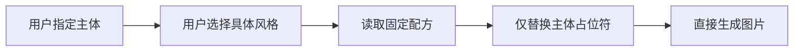

# 宝藏郎插画 Skills（baozl.com）

> 由 **[baozl.com](https://baozl.com)（宝藏郎）** 出品 · 开源地址 <https://github.com/sunwang115/bi-zhi-skill-> · 配套专家：[宝藏郎插画专家](https://github.com/sunwang115/bi-zhi-skill-)

一套面向 Codex / WorkBuddy 的中文插画生成技能合集，包含 **1 个总入口、8 个风格子技能、25 套固定提示词配方**。


用户只需指定主体与具体风格。Skill 会在内部套用固定配方并直接生成图片，不展示中间提示词，也不会擅自扩写主体或混合风格。

## 特点

- 25 种经过分类的固定插画风格
- 每种风格对应独立提示词配方与示意图
- 主体内容由用户明确提供，避免模型自行改写
- 主体与风格齐全后直接生成图片
- 支持从总入口选择，也可直接调用子技能
- 中文描述与中文交互

## 安装

将仓库克隆到本地：

```bash
git clone https://github.com/sunwang115/bi-zhi-skill-
```

复制 `skills/` 下的 9 个目录到 Codex Skills 目录。

macOS / Linux：

```bash
cp -R bi-zhi-skill/skills/baozl-* ~/.codex/skills/
```

Windows PowerShell：

```powershell
Copy-Item -Recurse -Force .\bi-zhi-skill\skills\baozl-* "$env:USERPROFILE\.codex\skills\"
```

安装后新建一个 Codex 任务或刷新技能列表。

## 使用

通过总入口：

```text
$baozl-illustration
主体：一只白色的猫躺在狗身上
风格：庭院手绘插画
```

直接调用子技能：

```text
$baozl-fashion-colorblock
主体：一个20岁的女性穿着短裙和白色T恤
风格：黄黑撞色插画
画幅：9:16
```

若缺少主体或具体风格，Skill 会先询问；信息齐全后直接生成图片。

## Skill 一览

| Skill | 风格 |
|---|---|
| `baozl-illustration` | 总入口：路由全部 25 种风格 |
| `baozl-editorial-minimal` | 精致极简、极简现代、极简冰蓝 |
| `baozl-fashion-colorblock` | 蓝白时尚、韩系蓝白、黄黑撞色、粉蓝撞色 |
| `baozl-soft-dream` | 复古柔焦、柔焦烟灰、梦幻鎏金、梦幻彩虹、柔焦霓虹 |
| `baozl-white-couture` | 柔纱纯白、华丽银灰 |
| `baozl-dark-fashion` | 暗调黑红、暗黑韩系、暗黑冷光 |
| `baozl-oriental-poetry` | 庭院手绘、东方青绿、极简墨灰 |
| `baozl-print-poster` | 复古剪影、复古电影、日式版画 |
| `baozl-cinematic-narrative` | 清冷夏日、童话巨宠 |

# 25 种插画风格

## 一、极简编辑插画

由 `baozl-editorial-minimal` 提供。

| 风格 | 视觉特点 | 示意图 |
|---|---|---|
| [精致极简插画](https://x.com/yyyole/status/2061644933287838180) | 干净流畅线条、柔和中性色、大面积留白，以少量亮色聚焦视觉。 |  |
| [极简现代插画](https://x.com/yyyole/status/2062773407020937534) | 北欧与韩系编辑线描，奶白、鼠尾草绿和墨黑色块结合旧纸颗粒。 |  |
| [极简冰蓝插画](https://x.com/yyyole/status/2070084443793166792) | 冰蓝冷调、优雅线条、抽象几何与半透明叠层，现代而清冷。 |  |

## 二、撞色时装插画

由 `baozl-fashion-colorblock` 提供。

| 风格 | 视觉特点 | 示意图 |
|---|---|---|
| [蓝白时尚插画](https://x.com/yyyole/status/2062435248231817530) | 蓝白骨架配色、锐利大色块、冷蓝硬边阴影与高级日系封面感。 |  |
| [韩系蓝白插画](https://x.com/yyyole/status/2063826058072465747) | 韩系商业视觉、半写实二次元、大面积高纯色块与强品牌识别度。 |  |
| [黄黑撞色插画](https://x.com/yyyole/status/2064248645369905614) | 明黄与纯黑强对比、硬边阴影、醒目克制的时尚杂志封面。 |  |
| [粉蓝撞色插画](https://x.com/yyyole/status/2073774407181643780) | 珊瑚粉天空、海军蓝阴影与深青中间色，融合日系时装和旅行海报。 |  |

## 三、柔焦梦幻插画

由 `baozl-soft-dream` 提供。

| 风格 | 视觉特点 | 示意图 |
|---|---|---|
| [复古柔焦插画](https://x.com/yyyole/status/2062892619458592977) | 低饱和复古水粉、暖灰雾粉、斑驳树影与被阳光漂白的旧画报感。 |  |
| [柔焦烟灰插画](https://x.com/yyyole/status/2063982747946009064) | 冷灰绿雾化背景、冷白侧逆光、纸面纹理与清冷忧郁氛围。 |  |
| [梦幻鎏金插画](https://x.com/yyyole/status/2065001375898243959) | 黄昏金色轮廓光与深海蓝阴影形成蓝橙对比，浪漫而怀旧。 |  |
| [梦幻彩虹插画](https://x.com/yyyole/status/2066465364146630742) | 粉蓝紫虹彩折射、高曝光柔光、半透明材质和空灵幻想质感。 |  |
| [柔焦霓虹插画](https://x.com/yyyole/status/2074857375329386732) | 青蓝环境与暖橙粉光线交织，带水汽、折射、胶片颗粒和梦幻失焦。 |  |

## 四、纯白高定插画

由 `baozl-white-couture` 提供。

| 风格 | 视觉特点 | 示意图 |
|---|---|---|
| [柔纱纯白插画](https://x.com/yyyole/status/2063139225428431118) | 纯白高曝光空间、百褶纱与欧根纱流动曲线，轻盈而诗意。 |  |
| [华丽银灰插画](https://x.com/yyyole/status/2065823008712007927) | 冰蓝白与银灰色系，薄纱、珠链、水晶和羽毛构成冷艳高定质感。 |  |

## 五、暗黑时尚插画

由 `baozl-dark-fashion` 提供。

| 风格 | 视觉特点 | 示意图 |
|---|---|---|
| [暗调黑红插画](https://x.com/yyyole/status/2063866436695814259) | 黑色与暗酒红主调，猩红霓虹硬光切割，冷艳、危险而疏离。 |  |
| [暗黑韩系插画](https://x.com/yyyole/status/2064602027217633679) | 黑与冷灰的丰富暗部层次，少量暗红点缀，强调材质与商业精修感。 |  |
| [暗黑冷光插画](https://x.com/yyyole/status/2066086016407240949) | 纯黑背景与局部冷白硬光，大量留黑，只保留轮廓和关键高光。 |  |

## 六、东方诗意插画

由 `baozl-oriental-poetry` 提供。

| 风格 | 视觉特点 | 示意图 |
|---|---|---|
| [庭院手绘插画](https://x.com/yyyole/status/2062083344083661002) | 白墙灰瓦、繁茂绿植与斑驳树影，水彩厚涂的治愈生活气息。 |  |
| [东方青绿插画](https://x.com/yyyole/status/2064180291946926369) | 青绿体系、大面积留白、湖面远山与轻雾构成清冷禅意空间。 |  |
| [极简墨灰插画](https://x.com/yyyole/status/2065361912238657858) | 冷灰、米白与浓墨块面结合月轮、倒影和纸纹，像高级诗集封面。 |  |

## 七、复古印刷插画

由 `baozl-print-poster` 提供。

| 风格 | 视觉特点 | 示意图 |
|---|---|---|
| [复古剪影插画](https://x.com/yyyole/status/2068266721841172760) | 米白、炭黑、暖黄三色，剪影、木刻颗粒与大量留白形成寓言感。 |  |
| [复古电影插画](https://x.com/yyyole/status/2070547539255030124) | 深青、红橙与奶油白的大色块，几何建筑切面和长投影营造电影感。 |  |
| [日式版画插画](https://x.com/yyyole/status/2074498667739033746) | 米白旧纸、深墨主体和少量鲜亮色块，融合昭和海报与木版画。 |  |

## 八、电影叙事插画

由 `baozl-cinematic-narrative` 提供。

| 风格 | 视觉特点 | 示意图 |
|---|---|---|
| [清冷夏日插画](https://x.com/yyyole/status/2067977304689816013) | 低机位仰视、钴蓝天空、冷白硬光和强烈蓝白对比，充满夏日透明感。 |  |
| [童话巨宠插画](https://x.com/yyyole/status/2070444305475571966) | 巨大与渺小的尺度反差、温暖灰白留白与静默凝视，像艺术电影童话。 |  |

## 工作方式



固定配方位于各子技能的 `references/recipes.md`；示意图位于对应 `assets/`。

## 仓库结构

```text
bi-zhi-skill/
├── README.md
├── LICENSE
├── NOTICE.md
└── skills/
    ├── baozl-illustration/
    ├── baozl-editorial-minimal/
    ├── baozl-fashion-colorblock/
    ├── baozl-soft-dream/
    ├── baozl-white-couture/
    ├── baozl-dark-fashion/
    ├── baozl-oriental-poetry/
    ├── baozl-print-poster/
    └── baozl-cinematic-narrative/
```

## 配套专家（宝藏郎插画专家）

除技能包外，本仓库同时提供 **Agent 型专家「宝藏郎插画专家」**（`baozl-illustration-expert`）：它会向用户收集「主体 + 风格」，再从内置的 25 套固定配方出图，适合作为对话框里的一站式插画助手。专家包已通过官方脚本注册到本地专家市场，并打包为 `baozl-illustration-expert.zip` 可直接上传到 WorkBuddy 专家中心。

## 上传到 WorkBuddy（技能 + 专家）

### 上传技能

1. 打开 WorkBuddy「技能中心 / 我的技能」→ 新建或上传技能。
2. 选择本仓库 `skills/` 下的技能目录：
   - 单技能快速上手：上传 `skills/baozl-illustration/`（已内置全部 25 套配方与示意图，可独立工作）；
   - 完整集合：分别上传 `skills/` 下 9 个 `baozl-*` 目录（总入口会自动路由到各子技能）。
3. 每个技能已带 `metadata`（作者 baozl.com、主页、emoji、版本、中英文简介、`visibility: public`）与 `_skillhub_meta.json`，上传后展示信息自动填充。

### 上传专家

1. 打开 WorkBuddy「专家中心 / 我的专家」→ 上传专家包。
2. 选择 `baozl-illustration-expert.zip`（已校验通过、含头像 `avatars/expert.jpg` 与 25 套内置配方）。
3. 上传后专家即可在对话框中调用，归属分类「内容创作」。

> 提示：专家与技能共用同一套固定配方与品牌。环境已安装 `baozl-illustration` 技能时，专家会优先调用该技能；否则用内置 `references/recipes.md` 独立工作。

## 许可证与素材说明

Skill 指令、提示词整理与仓库文档使用 [MIT License](LICENSE) · 由 baozl.com 维护。本仓库基于 [muyang-illustration-skills](https://github.com/yokel1121/muyang-illustration-skills)（作者 yokel1121，MIT）二次开发 / 重新品牌化，原作者署名保留。

示意图用于说明各风格的视觉效果，并保留原始发布链接。示意图不自动包含在 MIT 授权范围内；相关权利归原始权利人所有。详见 [NOTICE.md](NOTICE.md)。

